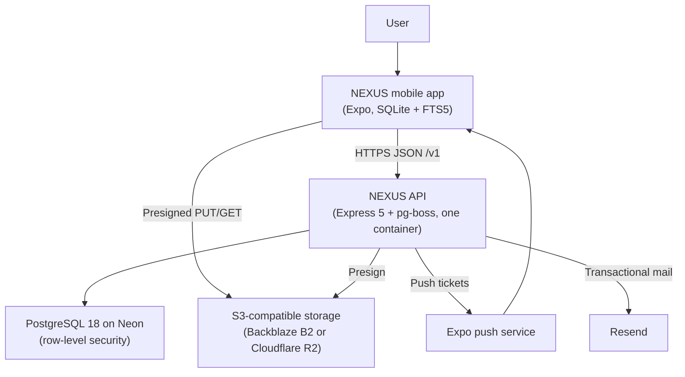

<p align="center">
  <strong>NEXUS</strong><br>
  <em>Your thinking, connected.</em>
</p>

<p align="center">
  <a href="https://github.com/OceTee/nexus-app/actions/workflows/ci.yml"></a>
  <a href="https://github.com/OceTee/nexus-app/actions/workflows/e2e.yml"></a>
  <a href="https://github.com/OceTee/nexus-app/actions/workflows/security.yml"></a>
  <a href="https://github.com/OceTee/nexus-app/actions/workflows/perf.yml"></a>
  <a href="https://github.com/OceTee/nexus-app/releases/latest"></a>
  
  
</p>

# NEXUS

NEXUS is a personal knowledge management app for Android and iOS. It lets one person capture, organise, connect and find their notes across all of their devices, and it works fully without an internet connection.

The phone is where the work happens, not the server. Every note, collection, tag, link and attachment reference lives in a database on the device, so writing, searching, following links and exploring the knowledge graph never wait on the network. Syncing between devices runs quietly in the background whenever a connection is available.

## Try it

- **Android:** download the APK from the [latest release](https://github.com/OceTee/nexus-app/releases/latest) and install it. Releases are signed, so a new version installs as an update.
- **Without an account:** tap **Continue offline**. Everything except sync works on the device: notes, links, the graph, search, history and export.
- **With an account:** sign up in the app to sync through the hosted API. The demo sends email from Resend's shared test address, which only delivers to the project owner, so new accounts can't be confirmed until the project has its own mail domain.
- **iOS:** not built yet; it needs a Mac or an Apple developer account.

## What it is meant to be

NEXUS is built so that notes behave like a second memory rather than a filing cabinet: quick to capture, always available, and quietly connected. Three principles shape it:

1. **The device comes first; the server keeps the record.** The app never blocks you on the network. The server's job is to put changes in order, spot conflicts and keep a safe history.
2. **Structure comes from writing.** Links, backlinks and the graph are built from what you type. Collections and tags are there when you want them, never required.
3. **You own your notes.** Exporting everything, managing your devices, seeing version history and deleting your account are core features, not support requests.

## The problems it solves

People who think in writing collect notes across apps and devices, then lose the connections between them. NEXUS answers each common pain point with a specific feature:

| Problem                                               | How NEXUS handles it                                                  |
| ----------------------------------------------------- | --------------------------------------------------------------------- |
| Edits made offline get lost or duplicated             | Every change is queued on the device and synced safely later          |
| Search stops working without a connection             | Full-text search runs on the device                                   |
| Links between notes are invisible                     | `[[wiki-links]]`, backlinks and an interactive knowledge graph        |
| Two devices disagree and one version silently wins    | Conflicts are detected and the other version is kept for you to merge |
| "What did this note say last week?" can't be answered | Version history with one-tap restore                                  |
| Getting your notes out of the app is hard             | One-step export of everything as Markdown or JSON                     |
| Slow, heavy mobile editors                            | A native app reading from a local database                            |

## What it does

- **Write in Markdown**: edit, preview and reading modes; pin important notes; a trash with a 30-day grace period.
- **Organise**: nested collections (up to six levels deep) and tags you can rename and merge.
- **Connect ideas**: type `[[` to link to another note, see every backlink with its context, and have links follow a note when it is renamed.
- **Explore the knowledge graph**: an interactive map of how your notes connect, with filters and quick previews.
- **Search instantly, even offline**: ranked full-text search with filters, entirely on the device.
- **Sync across devices**: changes reconcile in the background; a clear conflict screen lets you merge when two devices edited the same note.
- **Go back in time**: browse earlier versions of a note and restore any of them.
- **Attach files**: images and PDFs, viewable inside the app and cached for offline use.
- **Stay in control**: export everything, see and sign out any device, check sync status, lock the app with biometrics, and delete your account with a 30-day grace period.
- **Light and dark themes**, built to WCAG 2.2 AA accessibility standards.

## Who it is for

NEXUS is for individuals who write and think across more than one device and who want to own their notes. It is designed around three kinds of user:

- **Researchers and students**, such as a postgraduate who keeps one note per paper, links papers to concepts and needs to find "which paper said X" on a train with no signal.
- **Consultants and analysts**, such as someone travelling between client sites who captures meeting notes and whiteboard photos on flights, then exports a client's notes when the engagement ends.
- **Software engineers**, such as someone keeping runbooks and code snippets in Markdown, linking them to incident notes and checking version history after a bad edit.

NEXUS is a personal tool. Team workspaces, sharing and real-time collaboration are not part of it.

## Highlights

- **Offline-first:** SQLite with FTS5 on the device, an outbox that coalesces edits, revision-checked sync, and conflicted copies with a side-by-side merge.
- **Knowledge graph:** d3-force layout rendered with React Native Skia, capped at 500 notes with filters.
- **Security:** Argon2id passwords, rotating refresh tokens with reuse detection, PostgreSQL row-level security, rate limits, and an OWASP ZAP scan of the API in CI.
- **Tested end to end:** 96 % line coverage on the app and 92 % on the API, enforced in CI; 12 Maestro flows on an Android emulator; a k6 load test (50 devices, p95 under 300 ms against an 800 ms target).
- **One deployable:** a single container runs the Express 5 API and the pg-boss workers, applies migrations on start, and deploys only after CI passes.

## Architecture



The app talks to two network endpoints for user data: the API, and object storage through URLs the API signs. The API owns the database, signs storage URLs, and sends push notifications and email. There are no WebSockets: sync is request and response, nudged by a silent push when another device changes something.

## Sync protocol in 10 lines

1. Every local write updates SQLite and queues one operation per entity in the outbox; repeated edits merge into the pending one.
2. A sync runs on write (debounced 5 s), on reconnect, on foreground, on a silent push, or every 15 minutes.
3. The app sends up to 100 operations and its change-feed cursor in one `POST /v1/sync`.
4. The server applies each operation in its own savepoint, so one bad operation never blocks the rest.
5. An edit whose base revision matches the server's becomes the next revision.
6. A stale edit doesn't overwrite: the server keeps its copy and stores the device's text as a conflict version.
7. Each operation id is recorded, so a retried request returns the stored result instead of applying twice.
8. The response carries per-operation results, every change since the cursor, and any new conflicts.
9. The app applies results, changes, conflicts and the new cursor in one SQLite transaction.
10. Conflicts show as a banner; the person keeps one copy or merges both, and the choice syncs like any edit.

## Tech stack

The whole project is written in TypeScript and organised as a pnpm and Turborepo monorepo.

**Mobile app**

- **Expo SDK 58** (React Native 0.88, React 19) with **Expo Router** for navigation
- **expo-sqlite** with **FTS5** full-text search as the on-device database
- **d3-force** and **React Native Skia** for the knowledge graph
- **Zustand** for app state and **TanStack Query** for server data
- **React Hook Form** and **Zod** for forms and validation
- **expo-secure-store** for credentials and biometric app lock

**Backend**

- **Node.js 24** and **Express 5**
- **PostgreSQL 18** on **Neon**, accessed through **Drizzle ORM** with row-level security
- **Cloudflare R2** for attachments, using presigned uploads
- **pg-boss** for background jobs, stored in Postgres
- Its own authentication: **Argon2id** password hashing and **JWT** access tokens with rotating refresh tokens
- **pino** logging and **helmet** security headers
- **Expo push notifications** and **Resend** for email

**Shared code**

- `@nexus/shared`: Zod schemas, Markdown helpers and merge rules used by both the app and the API
- `@nexus/ui`: design tokens and UI building blocks

**Quality and delivery**

- **Vitest**, **Jest**, **React Native Testing Library**, **Supertest** and **Testcontainers** for tests; **Maestro** for end-to-end tests; **k6** for load tests
- **ESLint**, **Prettier**, **commitlint** and **gitleaks** in **GitHub Actions**
- **EAS Build** and **EAS Update** for app builds and over-the-air updates; **Railway** for hosting the API; **Sentry** for error monitoring

## Running locally

You need Node.js 24, pnpm 10 and Docker; the Android app also needs Android Studio.

```bash
pnpm install
docker compose up -d postgres minio && docker compose up minio-init
cp apps/api/.env.example apps/api/.env && pnpm --filter @nexus/api db:migrate
pnpm --filter @nexus/api dev
cd apps/mobile && cp .env.example .env && npx expo run:android
```

Windows notes and every script are in [docs/DEVELOPMENT.md](docs/DEVELOPMENT.md).

## Testing

| Suite                                      | Command                                    | Runs in CI              |
| ------------------------------------------ | ------------------------------------------ | ----------------------- |
| Unit, all packages                         | `pnpm test`                                | Every push              |
| API against PostgreSQL 18 (Testcontainers) | `pnpm --filter @nexus/api exec vitest run` | Every push              |
| End to end (Maestro, Android emulator)     | `node apps/mobile/.maestro/run.mjs`        | App changes and nightly |
| Load (k6, 50 devices)                      | `k6 run scripts/k6/sync-load.js`           | Weekly                  |
| Security (OWASP ZAP API scan)              | see `.github/workflows/security.yml`       | Weekly                  |

| Coverage (lines / branches)   | Now         | Target      |
| ----------------------------- | ----------- | ----------- |
| Mobile app                    | 96 % / 90 % | 80 % / 70 % |
| API (unit and database tests) | 92 % / 75 % | 80 % / 70 % |
| Shared package                | 99 % / 96 % | 95 % / 90 % |

CI fails any change that drops coverage below its target.

## Project structure

```text
apps/api          Express 5 API: routes, services, sync engine, background jobs
apps/mobile       Expo app: screens (app/), features, local database and sync (src/)
packages/shared   Zod schemas, Markdown helpers and merge rules used by both
packages/ui       Design tokens and UI building blocks
docs              Development, deployment, export format and the OpenAPI document
scripts           k6 load tests, coverage and ZAP report helpers
.github           CI, E2E, performance, security and release workflows
```

## Development

Setup instructions, scripts and Windows notes are in [docs/DEVELOPMENT.md](docs/DEVELOPMENT.md).

## Documentation

- [Development guide](docs/DEVELOPMENT.md): setup, scripts, testing and Windows notes
- [Deployment guide](docs/DEPLOYMENT.md): Render, Neon, Backblaze B2, Resend and releases
- [API reference](docs/api/openapi.json): OpenAPI 3.1, generated from the routes and their schemas
- [Export format](docs/export-format.md) and its [JSON schema](docs/schemas/nexus-export.schema.json)

## Roadmap

- **Next:** server-side export jobs, Obsidian and Markdown folder import, note templates and daily notes, an optional encrypted local database (SQLCipher).
- **Later:** read-only share links and a web viewer, text search inside attachments, home-screen widgets.
- **Eventually:** end-to-end encryption with user-held keys, and shared workspaces.

## Licence

MIT for code. The NEXUS name and brand assets are reserved.
